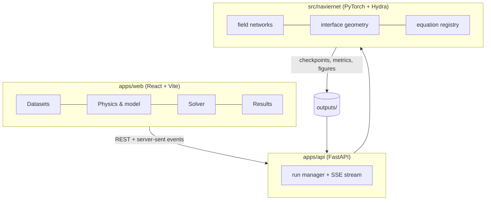
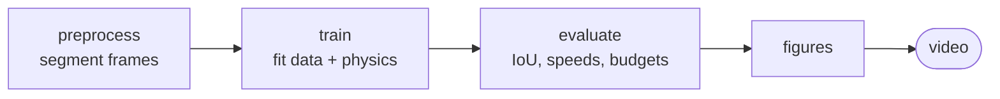

<div align="center">


# NavierNet

**Ten camera frames of a boiling bubble go in. The velocity, pressure and temperature fields come out.**

A high-speed camera can only record the shape of a bubble. NavierNet trains a neural network to fit
those frames *and* satisfy the conservation laws at the same time, so it can hand back the flow fields
the camera never saw, at any instant between the frames.

[](LICENSE)
[](.python-version)
[](src/naviernet)
[](apps/api)
[](apps/web)
[](configs)

[Why it exists](#why-it-exists) ·
[Results](#results) ·
[Architecture](#architecture) ·
[Pipeline](#the-pipeline) ·
[Quick start](#quick-start) ·
[Development](#development)

</div>

---

## Why it exists

A vapour bubble growing in a heated microchannel decides how well the channel cools. Watching one is
hard: the camera gives a silhouette every half millisecond and nothing else. The velocity, the
pressure and the temperature that drive the growth are all invisible.

The two usual answers both fall short.

| | Approach | Where it breaks |
|---|---|---|
| **A** | Fit or interpolate the images | Gives a prettier silhouette, still no physics and no velocity |
| **B** | Simulate it with CFD | Needs the nucleation site, the local superheat and the wall condition, which are exactly what you do not have |

NavierNet takes the third route. One network represents each field as a smooth function of space and
time. The recorded frames pull it toward the measurement, and the governing equations, evaluated by
automatic differentiation, pull it toward physics. What comes out satisfies both.

The interface is not left free to be any shape. It is built as an explicit capsule whose root sits at
the measured nucleation site and whose nose can only move forward, so the reconstruction stays a
bubble even where there are no frames to hold it in place.

## Results

Measured on one imaged event: FC-72 at 2 W/cm² in a 300 x 150 um channel, frames 0.5 ms apart.

| | |
|---|---|
| Agreement with the recorded frames | **IoU 0.93 to 0.98** |
| A frame withheld from training entirely | **IoU 0.968** |
| Nose speed, with no velocity data supplied | **177 mm/s** against 180 mm/s measured |
| Film thickness against Bretherton theory | **4.9 um**, matching the imaged side films |
| Energy budget against the wall setpoint | **1.9 W/cm²** against 2.0 W/cm² |

The mid-bubble waist that precedes pinch-off appears on frames the model never saw, which a freely
shaped interface does not produce at all.

## Architecture

A normal product surface wraps the solver. The browser drives the same pipeline the CLI does, so a
run started in either place is the same run.



Every run writes its fully resolved config next to its results, so any figure can be traced back to
the settings that produced it.

## The pipeline

Five stages, each reading its inputs from disk. Run them together or one at a time.



```bash
naviernet stage=all                        # everything
naviernet stage=train training.steps=500   # resumable, run it again to continue
```

## Quick start

One command from a fresh clone:

```bash
make run
```

That installs the toolchain, both Python packages and the web dependencies, then starts the API and
the web app on free ports and prints the URLs.

```bash
make            # command reference
make setup      # dependencies only
make stop       # tear everything down
make test       # Python and web suites
make lint       # ruff, eslint, tsc
```

The raw camera frames are not distributed with the repository. Drop your own TIFFs into
`data/raw/<name>/` and add a matching `configs/experiment/<name>.yaml`, or upload them in the browser
under Datasets.

## Configuration

Configuration is [Hydra](https://hydra.cc)-composed from typed dataclasses, so a wrong key or a wrong
type fails immediately instead of quietly producing wrong physics. One directory per group.

```bash
naviernet stage=all model.alpha_eps=0.03      # sharper interface
naviernet --multirun training.seed=0,1,2      # seed sweep
naviernet --cfg job --resolve                 # print the config, run nothing
```

| Group | Holds |
|---|---|
| `experiment/` | Operating conditions of one imaged dataset |
| `fluid/` | Saturated two-phase properties |
| `imaging/` | Segmentation and calibration |
| `scales/` | Non-dimensionalisation |
| `model/`, `training/` | Network architecture and optimisation |

Derived quantities such as the dimensionless groups are computed rather than configured, so they can
never drift away from the inputs they come from.

## Development

```bash
make test-all   # adds the slow and data-dependent tests, plus end-to-end
make lint-fix   # apply autofixes, then re-check
```

Tests that need the raw dataset or a trained checkpoint are marked and skip cleanly without them.

The server is meant for a local or trusted network. It has no authentication and it can start
training jobs and write to the repository, so do not expose it to the internet as it stands.

## License

[GNU GPL-3.0](LICENSE)
