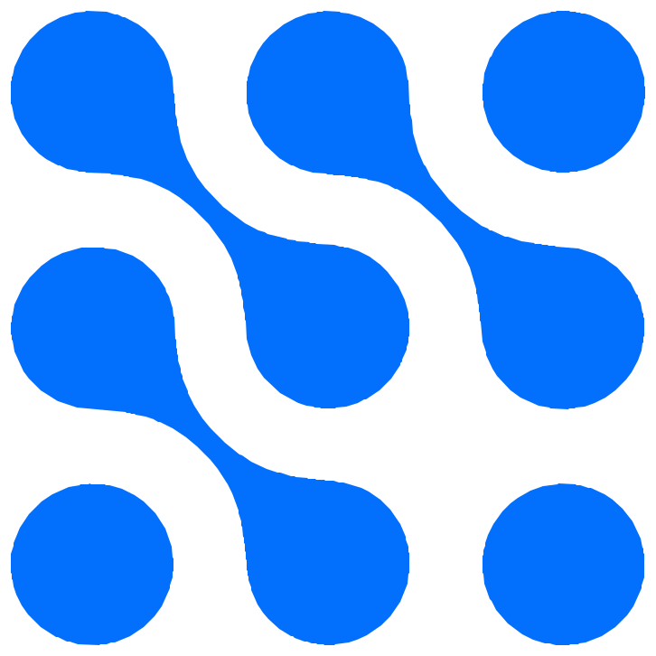

<div align="center">



# NavierNet

**Ten camera frames of a boiling bubble in, the velocity, pressure and temperature around it out.**

[](LICENSE)
[](.python-version)
[](src/naviernet)

</div>

A high-speed camera sees only a bubble's outline. NavierNet fits a physics-informed neural network to
those outlines and to the conservation laws at once, and so recovers the fields the camera cannot see,
at any instant between the frames. The case studied is FC-72 boiling in a 300 × 150 µm heated channel.

## How it works

Training runs in two stages.

1. **Outline.** The bubble is an explicit capsule rooted at the nucleation site. It is fitted to the
   traced outlines (the centre of the dark rim, made mirror-symmetric about the channel), then frozen.
2. **Fields.** With the outline fixed, the network solves for the flow, pressure and temperature
   around it.

The physics, in the depth-averaged 2D model:

| | |
|---|---|
| Flow | Brinkman law with the liquid's inertia: pressure against the floor and ceiling drag and in-plane viscous friction |
| Channel | Developed velocity profile at the inlet (15 mL/h); a stress-free outlet 1 mm past the view, its pressure left free |
| Bubble edge | Moves with the liquid; held at the boiling point; Young–Laplace imposed point by point away from the root, which sets the vapour pressure |
| Heat | Liquid energy equation, two heater zones on the floor |
| Evaporation | A thin film under the bubble dries out as the floor heats it; the total vapour made is held to the bubble's measured growth |

## Where it stands

The default run is `ghost8-15-s0` (15 mL/h, one seed). It starts about 5 ms before the first image from
a seed bubble, runs the channel 1 mm past the camera's view, includes the liquid's inertia, and holds
frame 6 out of every target. Measured against the images and against each equation's own terms:

| | |
|---|---|
| Blind frame 6 | IoU 0.990, never trained on, the traced outline included |
| Outline against the frames | IoU 0.981 to 0.992 |
| Liquid volume | conserved exactly; the bubble's growth matches the images within a few percent at frames 1 to 10 |
| Backflow beside the head | present from frame 7, as mass conservation on the images requires |
| Pressure along the channel | matches friction plus the liquid's braking in the open liquid (frame 9: 40 Pa/mm against 39) |
| Momentum residual (rms) | 0.18 at frames 1 to 9, 0.19 at frame 10 |
| Pressure jump at the edge | 22 Pa from Young–Laplace away from the root |
| Still open | the root's pressure jump (about 170 Pa off); frame 10's braking rests on growth after frame 11 leaves the view |

Every run ends with an audit and a report: the five-check gate, these relative errors, and figures of
every field.

## Quick start

```bash
make run    # install everything, start the API and the web app, print the URLs
make test   # Python and web tests
make lint   # ruff, eslint, tsc
```

Run the pipeline from the command line:

```bash
naviernet dataset=Series-1-w300 experiment=trusted_w300 model=trusted training=trusted
naviernet --cfg job --resolve        # print the composed config, run nothing
```

The default run's full command is at the top of `configs/experiment/ghost_w300.yaml`.

On a rented GPU through [Modal](https://modal.com), with a report afterwards:

```bash
modal run scripts/modal_bench.py --mode bench --seeds 0 --prefix my-run
python scripts/run_report.py my-run-s0
```

The outline fit is cached and reused by every later run on the same outlines, settings and code, so a
run is about 45 minutes after the first.

The raw camera frames are not in the repository. Put TIFFs in `data/raw/<name>/` with a matching
`configs/experiment/<name>.yaml`, or upload them in the browser.

## Layout

| | |
|---|---|
| `src/naviernet` | The solver: models, physics, training, audit |
| `configs` | [Hydra](https://hydra.cc) configs; `experiment/ghost_w300.yaml` holds the default run's full command |
| `apps/api`, `apps/web` | FastAPI server and React app over the same pipeline |
| `scripts` | Modal runs, run reports |

The server has no authentication and can start training jobs. Keep it on a local or trusted network.

## License

[GNU GPL-3.0](LICENSE)
