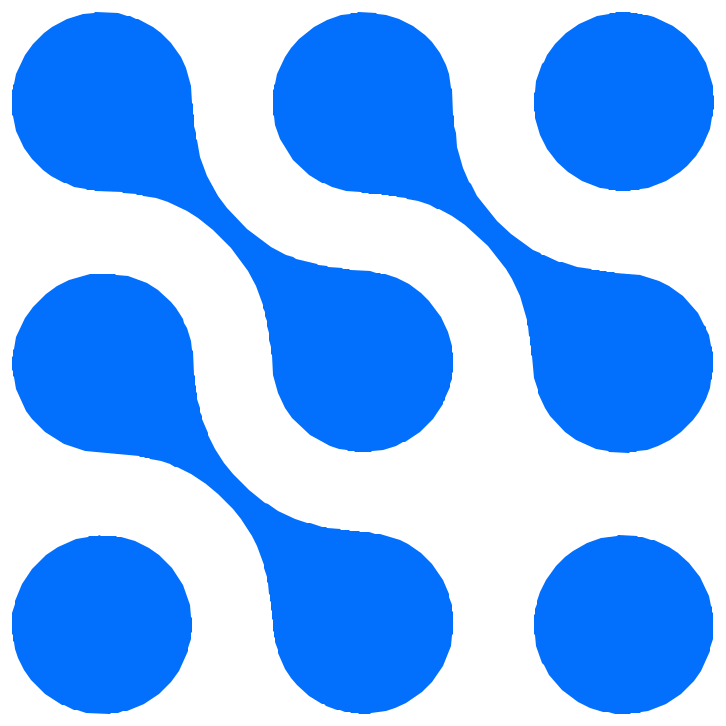

<div align="center">



# NavierNet

**Ten camera frames of a boiling bubble in, the velocity, pressure and temperature around it out.**

[](LICENSE)
[](.python-version)
[](src/naviernet)

</div>

A high-speed camera sees only a bubble's outline. NavierNet fits a physics-informed neural network to
those outlines and to the conservation laws at once, and so recovers the fields the camera cannot see,
at any instant between the frames. The case studied is FC-72 boiling in a 300 × 150 µm heated channel.

## How it works

Training runs in two stages.

1. **Outline.** The bubble is an explicit capsule rooted at the nucleation site. It is fitted to the
   traced outlines (the centre of the dark rim, made mirror-symmetric about the channel), then frozen.
2. **Fields.** With the outline fixed, the network solves for the flow, pressure and temperature
   around it.

The physics, in the depth-averaged 2D model:

| | |
|---|---|
| Flow | Brinkman law: pressure against the floor and ceiling drag and in-plane viscous friction |
| Channel | Developed velocity profile at the inlet (10 mL/h); stress-free outlet at a fixed pressure |
| Bubble edge | Moves with the liquid; held at the boiling point; Young–Laplace imposed on average, which sets the vapour pressure |
| Heat | Liquid energy equation, two heater zones on the floor |
| Evaporation | A thin film under the bubble dries out as the floor heats it; the total vapour made is held to the bubble's measured growth |

## Where it stands

From the current default (one seed), measured against the images and against each equation's own terms:

| | |
|---|---|
| Outline against the frames | IoU 0.977 to 0.990 |
| Vapour pressure | 116 to 172 Pa above the outlet, as Young–Laplace predicts for this channel |
| Liquid volume | conserved exactly: the backward flow beside the bubble's head that mass conservation on the images requires is there at every frame, reversing at 1.4 ms as in the outlines |
| What drives that backflow | the liquid pressure, rising about 31 Pa toward the nose along the gap (frame 9) |
| Temperature equation, relative to its terms | 7–9% at the bubble, 5–15% in the open liquid |
| Heat budget | closes within the gate (spread 0.27) |
| Still open | the pressure at the head's curved edge: 60–110 Pa above what Young–Laplace allows there, part of it a fixed step where the round nose meets the flat side; the liquid's inertia is not yet included (momentum 23–28% near the bubble) |

Every run ends with an audit and a report: the five-check gate, these relative errors, and figures of
every field.

## Quick start

```bash
make run    # install everything, start the API and the web app, print the URLs
make test   # Python and web tests
make lint   # ruff, eslint, tsc
```

Run the pipeline from the command line:

```bash
naviernet dataset=Series-1-w300 experiment=trusted_w300 model=trusted training=trusted
naviernet --cfg job --resolve        # print the composed config, run nothing
```

On a rented GPU through [Modal](https://modal.com), with a report afterwards:

```bash
modal run scripts/modal_bench.py --mode bench --seeds 0 --prefix my-run
python scripts/run_report.py my-run-s0
```

The outline fit is cached and reused by every later run on the same outlines, settings and code, so a
run is about 45 minutes after the first.

The raw camera frames are not in the repository. Put TIFFs in `data/raw/<name>/` with a matching
`configs/experiment/<name>.yaml`, or upload them in the browser.

## Layout

| | |
|---|---|
| `src/naviernet` | The solver: models, physics, training, audit |
| `configs` | [Hydra](https://hydra.cc) configs; `trusted` is the default recipe |
| `apps/api`, `apps/web` | FastAPI server and React app over the same pipeline |
| `scripts` | Modal runs, run reports |

The server has no authentication and can start training jobs. Keep it on a local or trusted network.

## License

[GNU GPL-3.0](LICENSE)
